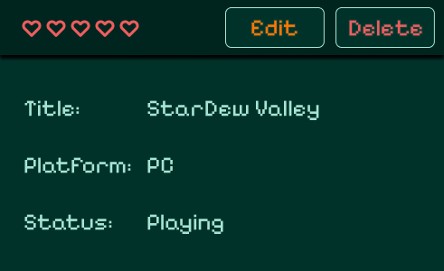

# 🎮 GameQuest - Your personal game-manager!

GameQuest is a game backlog application built with React, TypeScript, and Tailwind CSS. It lets users manage their game collection, track progress, and keep a record of the status on the games they're playing.

The application communicates with the external GameQuest API to store and manage game data.

## 🔗 Links

- **Live application:** [GameQuest on Vercel](https://fed-25-d-react-questlog.vercel.app/)
- **GitHub repository:** [GameQuest on GitHub](https://github.com/erik-grahn/FED25D_REACT_QUESTLOG)
- **API documentation:** https://questlog-api.vercel.app/docs

## 🍿 Features

- View all games in a personal game collection.
- Filter games by status: All, Want to Play, Playing, Completed, and Dropped. Filter is "remembered" by the browser by utilizing localStorage.
- View detailed information about individual games, including cover art, platform, rating, and notes.
- Add new games to the collection.
- Edit existing games, including status and rating.
- Delete games from the collection.
- Loading indicators while fetching data.
- Error handling for failed API requests.
- Navigation between pages using React Router.
- Responsive interface styled with Tailwind CSS.

## 👨🏼‍🎨 Design

Although design wasn't the main focus on this project, I leaned heavily on old-school computer colors and themes. Using pinterest to brainstorm themes and colors, and then Figma to create a simple "Game-Card" (see below), assisted in keeping the styling cohesive.



## 💻 Tech Stack

- **React** – Component-based user interface.
- **TypeScript** – Static typing and improved code reliability.
- **Vite** – Development server and build tool.
- **Tailwind CSS** – Styling and responsive layouts.
- **React Router** – Client-side routing and navigation.
- **API** – External REST API for game data.
- **localStorage** – Storage of the selected status filter.

## 🛫 Getting Started

### Requirements

Make sure you have the following installed:

- Node.js
- npm
- Git

### Installation

**1. Clone the repository**

```bash
git clone YOUR_GITHUB_REPOSITORY_URL
```

**2. Navigate to the project directory**

```bash
cd YOUR_REPOSITORY_NAME
```

**3. Install dependencies**

```bash
npm install
```

**4. Configure the API**

GameQuest uses an external API where each user has a unique handle to separate their game collection from others.

API base URL:

```text
https://questlog-api.vercel.app/api/:handle
```

Replace `:handle` with your own handle.

Example:

```text
https://questlog-api.vercel.app/api/my-handle
```

Update the API configuration in `src/config.ts` to use your chosen handle.

**5. Start the development server**

```bash
npm run dev
```

Open the local URL displayed in your terminal, usually:

```text
http://localhost:5173
```

The application should now be running locally.

## 🔌 API

GameQuest uses the external Questlog API.

**Documentation:** https://questlog-api.vercel.app/docs

**My API handle:** `granka`

**Base URL:**

```text
https://questlog-api.vercel.app/api/granka
```

The API does not require authentication. Each handle has its own game collection.

### API Endpoints

| Method | Endpoint                | Description             |
| ------ | ----------------------- | ----------------------- |
| GET    | `/games`                | Fetch all games         |
| GET    | `/games?status=playing` | Fetch games by status   |
| GET    | `/games/:id`            | Fetch a specific game   |
| POST   | `/games`                | Create a new game       |
| PATCH  | `/games/:id`            | Update an existing game |
| DELETE | `/games/:id`            | Delete a game           |

### Game Data

A game returned by the API has the following structure:

```json
{
  "id": "6b1f2a",
  "title": "Hollow Knight",
  "platform": "Switch",
  "status": "playing",
  "rating": 5,
  "coverUrl": "https://example.com/cover.jpg",
  "notes": "Stuck on Mantis Lords"
}
```

The `id` is generated by the API when a new game is created.

The application uses separate TypeScript types for existing and new games:

```ts
type NewGame = Omit<Game, "id">;
```

This allows new games to be created without providing an ID while ensuring existing games have one.

## 🪝 Custom Hooks

To keep components focused on rendering and user interaction, data fetching and API operations are managed by custom React hooks. The hooks are based on the requirements of the assignment, utilizing the names and functionality provided by the instructions.

### useGames(status)

Responsible for fetching a list of games from the API.

It manages:

- The games collection.
- Loading state.
- Error state.
- Fetching games when the provided status changes.

The hook also provides a way to update the local games state after deleting a game.

### useGame(id)

Responsible for fetching a specific game using its the games id.

It handles the API request, loading state and errors, allowing the game details page to focus on displaying information.

### useSaveGame()

Handles operations that modify game data.

It provides three functions:

- `createGame()` – Sends a POST request to create a game.
- `updateGame()` – Sends a PATCH request to update a game.
- `deleteGame()` – Sends a DELETE request to remove a game.

The hook also manages saving state and API errors.

### useLocalStorage()

A reusable hook that synchronizes React state with the browser's localStorage.

It is used to remember the selected game status filter.

When a user selects a filter:

1. React state updates.
2. The new value is saved to localStorage.
3. When the page reloads, the previously selected value is restored and implemented on the current session.

## 📑 Application Pages

| Page          | Description                                     |
| ------------- | ----------------------------------------------- |
| Games         | Displays the game collection and status filters |
| Specific Game | Shows information about an individual game      |
| New Game      | Form for creating a new game                    |
| Edit Game     | Form for updating an existing game              |
| Not Found     | 404 page for unknown routes                     |

The application uses React Router with a shared layout and navigation.

## 💾 Persistent Filtering

The status filter supports the following values:

- All
- Want to Play
- Playing
- Completed
- Dropped

The selected filter is stored in localStorage using the custom `useLocalStorage` hook.

This means users can refresh the page or return later without having to select their preferred filter again.

## 🎓 Assignment Information

**Assignment:** Inlämning 2 – Questlog (GameQuest)

**Target grade:** VG (Väl Godkänt)

The application is developed to fulfill the requirements for both G and VG.

## 🤖 Use of AI

AI (ChatGPT) was used as a learning and development tool throughout this project. I used it to better understand React, TypeScript, custom hooks, and other programming concepts, as well as to troubleshoot issues when I got stuck in my own code.

ChatGPT was used for explanations, guidance, and troubleshooting. All code was written and implemented by me. Codex was not used in this project.
