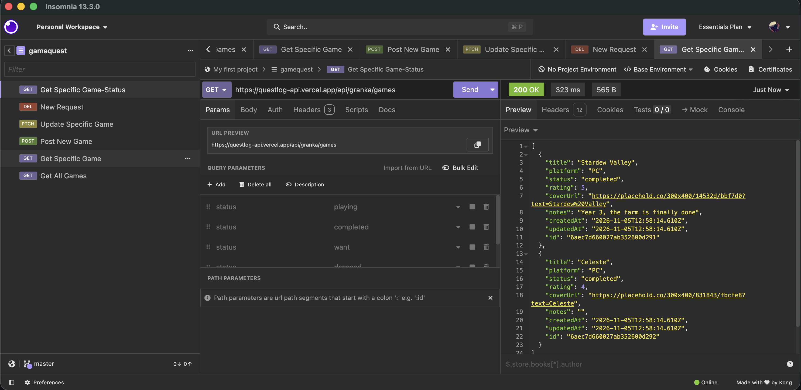

# Inlämning 2 – Questlog

## Översikt

Du bygger en React-app som skapar, läser, ändrar och tar bort data i ett externt API.
Appen kan passa bra i portfoliot.

## Uppgiften: Questlog

Questlog är din egen spelbacklog: spelen du vill spela, spelar just nu och har klarat.
Lista alla spel, och filtrera på status: Vill spela, Spelar, Klarat, Lagt ner
Öppna ett spel och se omslag, plattform, betyg och anteckningar
Lägg till ett spel, ändra det (till exempel status eller betyg) och ta bort det
Design och extra funktioner väljer du själv.

## API

Questlog API har ingen inloggning. I stället väljer du ett eget handle, till exempel anna-k ,
och dina spel sparas under det. Då blandas de inte med någon annans. Varje spel tillhör
ditt handle, och statusen gäller bara din post, inte någon annans.
Dokumentation: questlog-api.vercel.app/docs. Läs den först, och prova anropen direkt
där.

### Bas-URL

https://questlog-api.vercel.app/api/:handle,
https://questlog-api.vercel.app/api/anna-k/games .

Anropen, efter bas-URL:en:

| Metod  | URL                     | Beskrivning                                  |
| ------ | ----------------------- | -------------------------------------------- |
| GET    | `/games?status=playing` | Alla spel, eller en status                   |
| GET    | `/games/:id`            | Ett spel, eller 404                          |
| POST   | `/games`                | Nytt spel: `{ title, platform, status }`     |
| PATCH  | `/games/:id`            | Ändra det som skickas, t.ex. `{ rating: 5 }` |
| DELETE | `/games/:id`            | Ta bort spelet                               |

### API Check in Insomnia

## Bedömning Individuell inlämningsuppgift 2 (IG/G/VG)

Läranderesultat 5 och 6
Deadline Söndagen den 15/11

### G

CRUD, komponenter, routing, laddning och fel

### VG

Som G, plus custom hooks och ett sparat filter
(useLocalStorage)

## Inlämning 2 – Questlog

Ett spel ser ut så här:
{
"id": "6b1f2a",
"title": "Hollow Knight",
"platform": "Switch",
"status": "playing",
"rating": 5,
"coverUrl": "https://...",
"notes": "Fastnat på Mantis Lords"
}

## Krav för G

- Metod URL Gör:
  GET /games?status=playing Alla spel, eller en status
  GET /games/:id Ett spel, eller 404
  POST /games Nytt spel: { title, platform, status }
  PATCH /games/:id Ändra det som skickas, t.ex. { rating: 5 }
  DELETE /games/:id Ta bort spelet
- Sidor: en lista med alla spel, en sida per spel ( /games/:id ), ett formulär för nytt spel och en 404-sida
- Routing: React Router med en layout och navigering
- Filter: knappar för status (All, Want to play, Playing, Completed, Dropped) som visar
  bara de spelen
- CRUD: hämta, skapa och ta bort spel
- Komponenter: appen är uppdelad i komponenter som får data via props
- Laddning: medan data hämtas visas en laddningsindikator, t.ex. "Laddar spel...", i stället för en tom lista. Gäller både listan och sidan för ett spel
- Fel: kontroll av response.ok , och ett meddelande när något går fel
- TypeScript: en typ för ett spel
- Appen är deployad på Vercel, med en README

## Krav för VG

- Alla G-krav, plus:
- Inlämning
- Lämna in senast i slutet av vecka 8:
- Länk till ett publikt GitHub-repo
- Länk till appen på Vercel
- README med beskrivning, hur man kör appen, ditt handle och vilket betyg du siktar på
- Custom hooks: all fetch-logik ligger i egna hooks, inte i komponenterna. T.ex. useGames(status) för listan, useGame(id) för ett spel och useSaveGame() för POST,
  PATCH och DELETE, gärna samlade i en fil hooks/useGames.ts
- Spara filtret: det valda statusfiltret sparas med en useLocalStorage -hook (som i
  lektion 12), så att det finns kvar efter en omladdning
- I README:n förklarar du kort hur dina hooks fungerar, och varför du byggt så

## Löpande info om utvecklingen

- Jag har valt att typa varje spel med: id, title, platform, status, rating, coverUrl, notes. Status har jag gjort till en egen type som kan innehålla värdet: "want-to-play", "playing", "completed" eller "dropped" Rating coverUrl och notes är optional att lägga till, då "spel jag vill spela" inte kan vara ratade, ett spel kanske saknar cover som är tillgänglig, eller att man inte har några specifika notes för tillfället.
